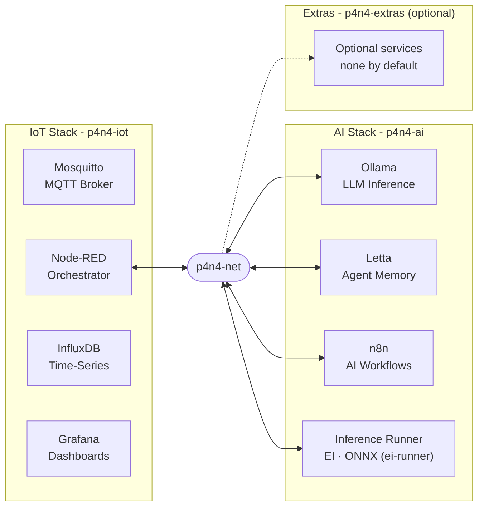
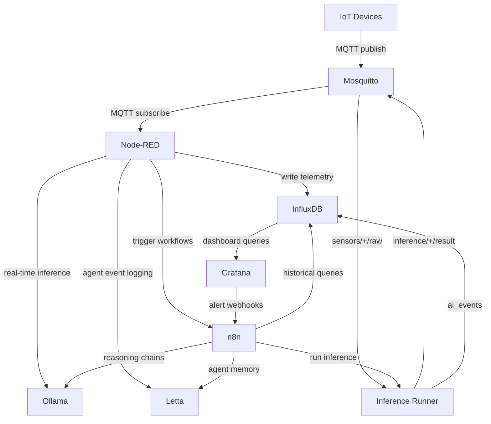

# p4n4 docs

> EdgeAI + GenAI Integration Platform
> Version 0.4 | 2026

**p4n4** (pronounced *"pana"*) is a self-hosted, open-source Docker Compose platform for small-to-medium IoT deployments augmented with an AI layer (Edge and/or Generative). It takes direct inspiration from the IoTStack TIGUITTO pattern and extends it with an **AI stack**: local GenAI (Ollama, with optional Letta and n8n), fast typed decisions (System 1) and on-device inference (Edge Impulse and ONNX).

---

## Quick Start

```bash
pip install p4n4
p4n4 init my-project
cd my-project
p4n4 up
```

See [Getting Started](getting-started.md) for the full walkthrough, including manual setup without the CLI.

---

## What's in the Box

| Stack | Services |
|-------|---------|
| [IoT](stacks/iot-stack.md) | Eclipse Mosquitto · Node-RED · InfluxDB · Grafana |
| [AI](stacks/ai-stack.md) | Ollama (+ optional Letta · n8n · System 1 · [inference runner](stacks/edge-inference.md): Edge Impulse `.eim` · ONNX · mock) |
| [Extras](stacks/extras.md) *(optional)* | Services outside the core, none by default; a template to add your own |

**Minimum requirements:** 4 GB RAM · 10 GB disk · Docker 24+ with Compose v2 · Python 3.11+

---

## Documentation

| Document | Description |
|----------|-------------|
| [Getting Started](getting-started.md) | Installation, first project, service URLs |
| [Troubleshooting](guides/troubleshooting.md) | Common failures and their fixes: container names, `p4n4-net`, logins, memory, the Pi 5 |
| [IoT Stack](stacks/iot-stack.md) | Mosquitto · Node-RED · InfluxDB · Grafana reference |
| [AI Stack](stacks/ai-stack.md) | Ollama · Letta · n8n reference |
| [Edge Inference](stacks/edge-inference.md) | The AI stack's inference runner (`ei-runner`): model backends, HTTP API |
| [Extras](stacks/extras.md) | Optional services: core vs extras, adding a service |
| [Migrating from the edge stack](guides/migrating-from-edge.md) | `p4n4 migrate edge`, by hand, and what changed names |
| [Dashboard Service](stacks/dashboard.md) | Web UI on port 8088 with a same-origin proxy |
| [CLI Reference](reference/cli-reference.md) | All `p4n4` commands |
| [Configuration](reference/configuration.md) | Every layer's `.env` keys: defaults, who reads them, which are shared across layers |
| [MQTT Topics](reference/mqtt-topics.md) | Every topic p4n4 publishes or consumes, with payloads and where each is stored |
| [REST API](reference/api.md) | p4n4-api: sign-in, project, stack and edge metrics endpoints |
| [Dashboard](reference/dashboard.md) | p4n4-dashboard: Flutter app for desktop and mobile |
| [Template Registry](reference/template-registry.md) | Using and contributing templates |
| [Hardware](reference/hardware.md) | p4n4-hw: KiCad designs, RPi5 GPIO scripts |
| [Emulator](reference/emulator.md) | p4n4-emu: workstation hardware emulation |
| [Security](guides/security.md) | Hardening guide: logins, MQTT device accounts and TLS, network exposure, secret rotation |
| [Development](guides/development.md) | Run a project on your checkout's lib, cli, api and dashboard (`scripts/dev`, `doctor`, `repos`) |
| [Deploying a template](guides/deployment.md) | Rehearse a template under p4n4-emu, then deploy it to Hetzner Cloud or a host you bring (GCP example) |
| [Emulators on AWS](guides/aws.md) | Set up an AWS account, run a project under p4n4-emu on an EC2 instance, take a report and its cost, delete the instance |
| [Emulators on Google Cloud](guides/gcp.md) | The same on Google Cloud: a project, a Compute Engine VM (Axion arm64), the report, billing by label, deletion |
| [Emulators on Azure](guides/azure.md) | The same on Azure: a resource group per run, a Cobalt 100 arm64 VM that deletes its own group at its TTL, the report, cost by resource group |
| [Emulators on DigitalOcean](guides/digitalocean.md) | The same on DigitalOcean: x86 Droplets only (native or QEMU mode), a team of its own, a Droplet that destroys itself at its TTL, cost from run time |
| [Raspberry Pi 5 node](guides/raspberry-pi.md) | A Pi 5 as a p4n4 node: OS, Docker, the stacks sized for 8 GB, the hardware daemon (LED, button), the emulator rehearsal |
| [Testing on a Jetson Orin Nano](guides/jetson.md) | Remote test host: Tailscale SSH, NoMachine desktop, Cloudflare Tunnel for web UIs, Ollama on the Jetson GPU |
| [Use case: greenhouse telemetry](https://github.com/raisga/p4n4-templates/blob/main/docs/use-cases/greenhouse-telemetry.md) | `mqtt-influx-grafana` template + p4n4-api + a white-label dashboard, tied together by `.p4n4.json` |
| [Use case: greenhouse assistant](https://github.com/raisga/p4n4-templates/blob/main/docs/use-cases/greenhouse-assistant.md) | `mqtt-influx-grafana-ollama`: the same project plus a local LLM that answers from the readings, and moving a project onto it |
| [Use case: road traffic](https://github.com/raisga/p4n4-templates/blob/main/docs/use-cases/road-traffic.md) | `mqtt-influx-grafana-ollama-go2rtc`: road traffic counting with ALPR, with live video, an assistant and plates kept for a retention period |
| [Architecture](reference/architecture.md) | Multi-repository architecture reference |
| [Design Document](decisions/design.md) | Architecture, data flow, design decisions |
| [Specifications Roadmap](decisions/specs.md) | Feature specs, acceptance criteria, release milestones |
| [ADR-001](decisions/adr/ADR-001.md) | Multi-repository architecture decision record |
| [ADR-002](decisions/adr/ADR-002.md) | Per-layer subdirectories in multi-layer projects |
| [ADR-003](decisions/adr/ADR-003.md) | The dashboard ships as a web container by default |
| [ADR-004](decisions/adr/ADR-004.md) | An encoder classifier for bounded decisions (System 1) |
| [ADR-005](decisions/adr/ADR-005.md) | Edge inference joins the AI stack; p4n4-edge becomes p4n4-extras |
| [AI Harness (draft)](decisions/ai-harness.md) | Building p4n4 projects with coding agents: harness tools, community extras (`stacks/extras/`), the p4n4 Car reference project and its OBD-II spike |
| [System 1](decisions/system1.md) | Fast typed decisions with Laya: spike results, rules of use, architecture, phases (S1, S2, the S3 infrastructure and S4 implemented) |
| [Recording in core (draft)](decisions/recording.md) | `p4n4 record`: demo videos per theme, role and viewport from declarative scenarios |
| [Releasing](project/releasing.md) | Release set order, what to do before publishing, `gh release` commands, how to write a release body |

---

## System Overview

### Stack Topology

p4n4's core is two cooperating stacks sharing a Docker bridge network (`p4n4-net`); optional services live in a third, extras, that nothing in the core depends on:



Node-RED sits at the intersection of the IoT and AI stacks. It subscribes to Mosquitto, normalises and routes data to InfluxDB, and can simultaneously call n8n webhooks or directly query Ollama/Letta APIs when AI reasoning is needed.

### Data Flow



---

## Design Philosophy

| Principle | Description |
|-----------|-------------|
| **Open Source First** | Every component is freely available and self-hostable |
| **Composable** | Stacks can be deployed independently or together |
| **Docker-native** | Single `docker-compose.yml` per stack with clean overrides |
| **Edge & Cloud Ready** | Runs from Raspberry Pi class hardware up to cloud VMs |
| **AI-Augmented IoT** | Sensor data and AI reasoning exist in the same data fabric |

---

## Hardware Profiles

| Profile | Hardware | Stacks | Recommended Models |
|---------|----------|--------|--------------------|
| Edge Minimal | Raspberry Pi 5 (8 GB) | IoT only | N/A |
| Edge AI | Raspberry Pi 5 + Coral/Hailo | IoT + GenAI (CPU) | `phi3:mini` |
| Edge GPU | NVIDIA Jetson Orin Nano (8 GB) | All (Ollama on the GPU) | `gemma4:e2b`, `qwen2.5:3b` |
| Mid-range Server | Intel NUC / x86 (16 GB RAM) | All | `mistral:7b` |
| GPU Workstation | NVIDIA RTX 3080+ (16 GB VRAM) | All | `llama3:8b` |
| Cloud VM | AWS t3.xlarge / GCP n2-standard-4 | All | `mistral:7b` or API |

**Workstation emulation:** `p4n4-emu` applies Docker resource constraints per hardware profile so your workstation behaves like target edge hardware — no physical board required. See the [Emulator reference](reference/emulator.md).

---

## Security

All default passwords are **placeholders only**. `p4n4 init` generates strong secrets; without
the CLI, replace them in `.env` before the first start, because InfluxDB, Grafana and n8n keep
the values they first start with. `p4n4 secret rotate` later replaces the Node-RED and Letta
passwords:

```bash
p4n4 secret rotate
```

Key hardening steps:

- Set `MQTT_USER` / `MQTT_PASSWORD` so devices need a login (the stack's own services use an internal listener), and add an account per device, an ACL and TLS in production.
- Place a reverse proxy (Nginx, Caddy, Traefik) in front with TLS termination.
- Never commit `.env` to version control — only `.env.example` is committed.

See the [Security guide](guides/security.md) for the full hardening walkthrough.

---

## Roadmap

### Released

| Component | Version | Ships as |
|-----------|---------|----------|
| p4n4 (CLI) | 0.4.0 | PyPI `p4n4` |
| p4n4-lib | 0.4.0 | PyPI `p4n4-lib` |
| p4n4-api | 0.3.0 | `ghcr.io/raisga/p4n4-api` (amd64, arm64) |
| p4n4-dashboard | 1.3.0 | `ghcr.io/raisga/p4n4-dashboard` (amd64, arm64); desktop and mobile builds from CI |
| p4n4-system1 | 0.1.0 | `ghcr.io/raisga/p4n4-system1` (amd64, arm64) |
| p4n4-iot, p4n4-ai, p4n4-extras | untagged | Scaffolded from each repo's `main` by `p4n4 init` |
| p4n4-emu, p4n4-hw | 0.1.0 | From a checkout (`tools/emu`, `tools/hw`); not on PyPI yet |

How these are cut and published is in [Releasing](project/releasing.md).

### Phase 1 — Foundation (v0.1)
- [x] IoT stack: Mosquitto · Node-RED · InfluxDB · Grafana
- [x] GenAI stack: Ollama · Letta · n8n integrated via Node-RED
- [x] Edge inference: runner with Edge Impulse, ONNX and mock backends (now the AI stack's `ei-runner`)
- [x] `p4n4 init`, `up`, `down`, `status`, `validate` CLI commands
- [x] `p4n4-api` v0.1: JWT sign-in, project, stack status and edge metrics (read-only)
- [x] `p4n4-dashboard`: Flutter app with Services, Edge, Agent, Grafana and Video tabs
- [x] Published to PyPI as `p4n4`

### Phase 2 — Intelligence Layer (v0.2)
- [x] System 1: fast typed decisions with laya (`p4n4-system1` 0.1.0, `p4n4 ai system1`); its exit criteria are still open (see below)
- [x] Dashboard sign-in with roles, assistant, Feed and Home (p4n4-dashboard 1.2.0)
- [x] Kiosk mode, per-view settings, a banner, account tools and the vision overlay (p4n4-dashboard 1.3.0 with p4n4-api 0.3.0)
- [x] Edge inference merged into the AI stack; optional services in `extras`; `p4n4 migrate edge` ([ADR-005](decisions/adr/ADR-005.md), CLI 0.4.0)
- [x] MQTT device logins, ACLs and TLS in the IoT stack ([Security](guides/security.md))
- [x] First official community templates published (six in [p4n4-templates](reference/template-registry.md))
- [ ] Pre-built Letta agent personas: Site Monitor, Anomaly Analyst, Operator Assistant
- [ ] Node-RED AI palette: Ollama, Letta and InfluxDB subflows (only `p4n4-system1` exists)
- [ ] n8n workflow library: the four AI-augmented workflows (six workflows ship today)
- [ ] `p4n4 ei` subcommands: deploy, run, status (stubs today), list, infer, update, info
- [ ] `p4n4 template search/install/list` (stubs today), `add`, `remove`, `upgrade`

### In progress
- [ ] **p4n4-lib and CLI 0.4.1:** `p4n4 up` creates `p4n4-net` on `P4N4_SUBNET` instead of always on `172.20.0.0/16` (fixed in the checkout, not released; [Releasing](project/releasing.md))
- [ ] **Smoke test of the 0.4 line:** a full `p4n4 up` of iot + ai + the inference runner, and `p4n4 migrate edge` on a real project, haven't been run yet
- [ ] **System 1 exit criteria:** p95 latency on a native Raspberry Pi 5, the regression suite on arm64, the gates on a real site's file, and the U3–U6 question sets ([System 1](decisions/system1.md))
- [ ] **p4n4-emu on PyPI:** the publish workflow is ready; the PyPI trusted publisher isn't set up

### Next
- [ ] An `api` layer: `p4n4 up` runs p4n4-api for the project and creates its first admin (today the API is started by hand)
- [ ] The MkDocs site for these docs
- [ ] TLS in the `p4n4 init` wizard
- [ ] An extras catalog and `p4n4 extra add` ([AI harness draft](decisions/ai-harness.md))

### Phase 3 — Scale & Extensibility (v0.3+)
- [ ] Multi-site federation
- [ ] OpenTelemetry integration for stack observability
- [ ] Embedding pipeline via `nomic-embed-text` into Letta archival memory
- [ ] Optional Kafka/NATS layer for high-throughput deployments
- [ ] Kubernetes / Helm chart (optional, multi-node)
- [ ] `p4n4 template upgrade` — delta merge with changelog
- [ ] Shell completion of stack names (commands already complete: `p4n4 --install-completion`)

Feature-level status and acceptance criteria are in the [Specifications Roadmap](decisions/specs.md).

---

## Repository Map

```
p4n4/                       (monorepo — you are here)
├── stacks/
│   ├── iot/                ← IoT stack (p4n4-iot)
│   ├── ai/                 ← AI stack: GenAI + edge inference (p4n4-ai)
│   └── extras/             ← Optional services (p4n4-extras, formerly p4n4-edge)
├── lib/                    ← Shared library (p4n4-lib)
├── cli/                    ← Python CLI — pip install p4n4 (p4n4-cli)
├── api/                    ← REST API gateway (p4n4-api)
├── dashboard/              ← Flutter dashboard app (p4n4-dashboard)
├── tools/
│   ├── hw/                 ← Hardware designs + RPi5 scripts (p4n4-hw)
│   ├── templates/          ← Community templates (p4n4-templates)
│   └── emu/                ← Hardware emulator for workstation dev (p4n4-emu)
├── docs/                   ← this documentation (p4n4-docs)
├── scripts/                ← run p4n4 from source: dev, doctor, repos (see Development)
├── projects/
│   └── sandbox/            ← Sandbox projects for local testing (p4n4-sandbox, private)
└── web/
    ├── blog/               ← Project blog (p4n4-blog)
    └── p4n4.com/           ← Public website (private)
```

---

## Appendix

### Port Reference

| Service | Stack | Port(s) | Exposure |
|---------|-------|---------|----------|
| Mosquitto | iot | 1883, 9001 (8883 with TLS) | IoT devices (a login once `MQTT_PASSWORD` is set); the stack's services use `mqtt:1883` on `p4n4-net` |
| Node-RED | iot | 1880 | Operators (login required), internal services |
| InfluxDB | iot | 8086 | Node-RED, Grafana, n8n |
| Grafana | iot | 3000 | Operators (browser) |
| MQTTX Web (optional) | iot | 8081 | MQTT web client (`mqtt-ui` profile) |
| Ollama | ai | 11434 | Node-RED, Letta, n8n on `p4n4-net`; host port on `127.0.0.1` (`OLLAMA_BIND`) |
| Letta | ai | 8283 | Node-RED, n8n on `p4n4-net`; host port on `127.0.0.1` (`LETTA_BIND`) |
| n8n | ai | 5678 | Operators, Grafana webhooks |
| Inference runner | ai | 8080 | Health and test inference (no auth); host port on `127.0.0.1` (`EI_RUNNER_BIND`) |
| p4n4 REST API | api | 8000 | Dashboard and other clients (binds `127.0.0.1` by default) |
| p4n4 Dashboard (web) | dashboard | 8088 | Operators (browser) |

### TIGUITTO vs p4n4

| Capability | TIGUITTO (IoTStack) | p4n4 |
|------------|---------------------|------|
| Data ingestion | Telegraf (metrics agent) | Node-RED (visual flow engine) |
| MQTT broker | Eclipse Mosquitto | Eclipse Mosquitto |
| Time-series DB | InfluxDB | InfluxDB |
| Visualisation | Grafana | Grafana |
| Conditional logic | Limited (Telegraf processors) | Full (Node-RED function nodes) |
| Device actuation | No | Yes (MQTT out, HTTP out) |
| Protocol bridging | MQTT only | MQTT, HTTP, WebSocket, Modbus, OPC-UA… |
| AI integration | No | Yes — Ollama, Letta, n8n |
| Workflow automation | No | Yes — n8n |
| Agent memory | No | Yes — Letta |
| Local LLM | No | Yes — Ollama (phi3, mistral, llama3) |
| Visual programming | No | Yes — Node-RED editor |
| Edge deployment | Yes (Pi compatible) | Yes (Pi 5 + optional GPU) |

### Key Environment Variables

```bash
# Mosquitto (IoT .env): with a password set, devices need a login
MQTT_USER=devices
MQTT_PASSWORD=                    # empty: devices connect anonymously

# InfluxDB
INFLUXDB_USERNAME=admin
INFLUXDB_PASSWORD=changeme
INFLUXDB_TOKEN=changeme
INFLUXDB_ORG=ming
INFLUXDB_BUCKET=raw_telemetry

# Grafana
GRAFANA_USER=admin
GRAFANA_PASSWORD=changeme

# Node-RED editor login (empty password refuses every login)
NODE_RED_USER=admin
NODE_RED_PASSWORD=changeme

# n8n (the login is the owner account created on the first visit)
N8N_ENCRYPTION_KEY=changeme       # 32+ characters; keep it once n8n has stored credentials

# Letta
LETTA_SERVER_PASSWORD=changeme

# Inference runner (AI .env, ei-runner profile)
MODEL_BACKEND=auto                # auto | eim | onnx | mock
EI_MODEL_FILE=model.eim
ONNX_MODEL_FILE=model.onnx
EI_API_KEY=                       # optional, Edge Impulse cloud features only
```

> Cross-stack note: `INFLUXDB_TOKEN`, `INFLUXDB_ORG`, and `INFLUXDB_BUCKET` must be identical across all stack `.env` files when deploying manually. The CLI handles this automatically: `p4n4 init` writes the shared values identically to every layer's `.env` ([ADR-002](decisions/adr/ADR-002.md)). Every key, per layer, is in the [Configuration reference](reference/configuration.md).
