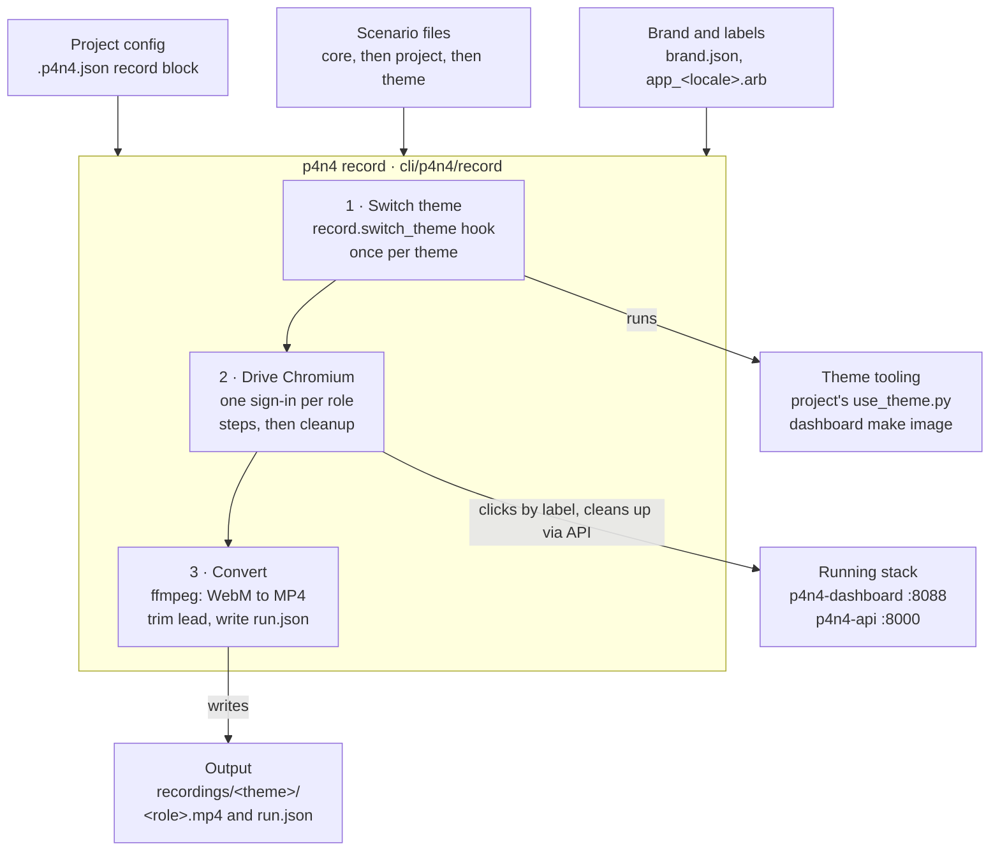

# p4n4 — Recording in core

**Version:** 0.2  
**Date:** 2026-10-15  
**Status:** Draft, not implemented

## Summary

Move a client project's walkthrough recorder into the p4n4 CLI as `p4n4 record`, so any p4n4 project can produce polished demo MP4s per theme, per role (`normie`, `power`, `admin`) and per viewport (desktop, phone, tablet). Walkthroughs become declarative scenario files: core ships one default per role, and a project or theme overrides them.

The target is demo and sales video, so the design favours watchable pacing, brand fidelity and reproducible output over test strictness. A failed step is logged and skipped where the video can still make sense, as the script does today.

## Current state

A client project's `scripts/record_walkthrough.py` (505 lines, a `uv run --script` with Playwright) records three MP4s per theme (desktop, phone and tablet), always as `normie`. It lives in one project and reaches into the p4n4 checkout by relative path (`ROOT.parents[2] / "dashboard"`, `/ "api"`).

What one run does, per theme:

1. Switches the project to the theme with the project's own `scripts/use_theme.py` (config, Grafana, store language), then runs `p4n4-dashboard:<brand id>`, building it with `make image THEME=…` if missing.
2. Starts p4n4-api with `P4N4_API_DEV_USERS=true` if none answers on `$P4N4_API_URL`, logging to `recordings/p4n4-api.log`.
3. Per viewport (see [Viewports](#viewports)), opens a fresh headless Chromium in the brand's `defaults.locale` and `themeMode`, injects a drawn pointer (a fingertip on touch viewports), and turns on Flutter's semantics tree.
4. Signs in as `normie` / `p4n4`, steps through the first-sign-in tour, opens each tab in `normieTabs` by `tabOrder` (Cameras last), asks the brand's first Assistant suggestion and waits up to 180 s for the answer, opens all cameras, signs out.
5. Trims Flutter's loading lead and converts WebM to H.264 MP4 (CRF 18, 30 fps) with ffmpeg; restores the original theme unless `--keep`.

What works well and should carry over: clicking by the localised labels in `lib/l10n/app_<locale>.arb` (no test ids needed), the `--pace` multiplier, the drawn cursor, the failure screenshot, and trimming the blank lead.

Limits that block a core move:

- One role, hard-coded: user, password, tab list and dwell times are constants.
- The flow is Python code; changing it means editing the script.
- Theme switching depends on `use_theme.py`, which only that project has.
- Paths assume the monorepo layout; it does not work from a `pip install p4n4` project.
- It relies on the dev users, which exist only with `P4N4_API_DEV_USERS=true`.

## Goals and non-goals

Goals:

- `p4n4 record` works in any p4n4 project, installed from PyPI or from the monorepo via `scripts/dev p4n4 record`.
- One MP4 per theme × role, from one command: `p4n4 record --role normie,power,admin --theme brand-a,brand-b`.
- Each role's video shows what that role sees and can do: its tabs, plus one or two actions only it has.
- Walkthroughs are data (scenario files), with core defaults per role and overrides per project and per theme.
- Each theme × role at every viewport: desktop, and the responsive phone and tablet layouts as touch devices.
- Same quality as today: drawn pointer, `--pace`, trimmed lead, H.264 MP4 at device pixels (1920×1080, 1170×2532, 1536×2048).

Non-goals:

- Not an end-to-end test framework. Steps fail soft; no assertions, no CI gating.
- No recording from the dashboard or p4n4-api (no server-side jobs, no uploads).
- No narration, captions or music in this version; chapter markers are an open question.
- Not a replacement for each project's theme tooling: core calls a hook, it does not reimplement `use_theme.py`.

## Account tiers

Each role gets its own default scenario: the shared opening (sign in, tour, Home), its tabs, then the actions only it has. The roles map onto p4n4-api's ranked `ROLES = ("normie", "operator", "admin")`; the dashboard and the dev users call `operator` "power".

| Role (`--role`) | API role | Tabs shown | Role actions in the default scenario | Target length |
| --- | --- | --- | --- | --- |
| `normie` | `normie` | brand `normieTabs`, in `tabOrder`, Cameras last | Ask the first Assistant suggestion; open all cameras (today's flow) | 1.5–2.5 min |
| `power` | `operator` | brand `powerTabs` | Act on a feed item (its first action); choose the Assistant's model; the connection label shows in the header | 2–3 min |
| `admin` | `admin` | every brand tab, plus Clients | Settings → Views (normie and power tabs, tab order); preview the normie view; set and clear a banner; stack controls on Services | 3–4 min |

Rules that apply to all three:

- Tabs come from the live `GET /api/v1/dashboard/views` when an admin has set them, else the brand's `defaults`, so the video matches what that deployment really shows.
- Role actions that change state (feed action, banner, Views) are undone by the scenario's `cleanup` steps, so recording leaves the demo as it was.
- Admin videos never show user management or secrets screens: they would put real usernames on a sales video.
- Credentials come from `--user`/`--password` per role or a `record.users` map; the dev users (`normie`, `power`, `admin` / `p4n4`) are the fallback only when the API runs with `P4N4_API_DEV_USERS=true`.

## Viewports

Every run records each theme × role at all three viewports; there is no flag to pick some. They differ in layout and input, not in scenario: the same scenario file drives all three.

| Viewport | CSS size | Pixel density | Video | Input | Dashboard layout |
| --- | --- | --- | --- | --- | --- |
| `desktop` | 1920×1080 | 1× | 1920×1080 | mouse, drawn pointer | side rail |
| `phone` | 390×844 | 3× | 1170×2532 | touch, fingertip while down | bottom bar |
| `tablet` | 768×1024 | 2× | 1536×2048 | touch, fingertip while down | bottom bar |

What the runner does differently on a touch viewport:

- **Navigation.** Under 800 px wide the dashboard swaps the rail for a bottom bar of up to five tabs; the rest become app-bar icon buttons labelled with the tab's name. The rail's destinations are buttons named `<label> Tab i of n`, the bottom bar's are `tab`s named `<label>`, so a nav lookup tries both, the bottom bar's first: Home's shortcuts carry the same names, and on a tablet they are on screen, left of the bar's tabs.
- **Taps and scrolls.** Sent as CDP `Input.dispatchTouchEvent` (Playwright's touchscreen can only tap, not hold or drag): a tap holds for 150 ms so the fingertip shows, and a scroll is a slow swipe mid-screen, held before lifting so it doesn't fling. Touch input also keeps Flutter's hover tooltips out of the video.
- **Sharpness.** Playwright's screencast records at the browser's own scale, not the emulated one, so Chromium is launched with `--force-device-scale-factor=<density>` as well as the context's `device_scale_factor`. With only the emulated one, the video is CSS-sized in the corner of a grey frame.
- **Tour.** Each viewport is a fresh browser context, so the first-sign-in tour (kept per browser) plays in every video.

## Architecture

One command switches each theme once, then records every role.



Stage 1 runs once per theme; stages 2 and 3 run once per role and viewport. Scenarios resolve before any browser opens, so `--dry-run` stops there.

Modules in `cli/p4n4/record/`:

- `command.py`: the Typer command, option parsing, theme × role × viewport loop.
- `scenario.py`: load, `extends` merge, validate the step vocabulary, resolve arb keys.
- `runner.py`: today's `Walk` (find by label, tap or touch, type, scroll or swipe, pace), one handler per step, `cleanup` in a `finally`.
- `stack.py`: p4n4-api reachability and dev-user check, the `switch_theme` hook, dashboard image and health.
- `video.py`: lead trim and ffmpeg conversion, `run.json`.
- `scenarios/normie.yaml`, `power.yaml`, `admin.yaml`: the core defaults.

## CLI, scenario format and storage

### Command

```
p4n4 record [--theme T,… | --all-themes] [--role normie,power,admin | --all-roles]
            [--scenario FILE] [--no-switch] [--rebuild] [--keep]
            [--url URL] [--api-url URL] [--out DIR] [--pace 0.75]
            [--chromium PATH] [--dry-run]
```

Defaults: the active theme, role `normie`, out `recordings/`. The run is theme-major (switch once, record every role at every viewport), since a switch costs minutes and a role costs a sign-in. `--dry-run` resolves and prints each theme × role scenario without opening a browser. Playwright ships as an optional extra, `pip install 'p4n4[record]'`; ffmpeg and Docker are checked up front with a clear message.

### Scenario file

YAML, one file per role. Steps are a small fixed vocabulary that the runner implements; labels are arb keys, resolved in the brand's locale, so one file works in every language.

```yaml
# p4n4 record scenario
role: power
extends: default          # core's power scenario; omit to start from scratch
dwell: { feed: 6, agent: 3, grafana: 8, video: 7 }
steps:
  - sign_in
  - tour
  - pause: 4
  - tabs: { order: views, last: [video] }   # views = live Views, else brand defaults
  - on_tab:
      feed: [ { scroll: 500 }, { feed_action: first } ]
      agent: [ { choose_model: first }, { ask: suggestion } ]
      video: [ { tap: allCameras, optional: true } ]
  - sign_out
cleanup:
  - api: { undo: feed_action }
```

Step vocabulary for v1: `sign_in`, `tour`, `tabs`, `on_tab`, `tap` (arb key or literal text), `type`, `ask`, `scroll`, `pause`, `wait_gone`, `open_settings`, `sign_out`, plus role-action steps (`feed_action`, `choose_model`, `set_views`, `preview_view`, `banner`). Any step takes `optional: true`; a missing optional label logs `!` and goes on, a missing required one stops that role with a screenshot.

### Lookup order

For theme T and role R, the first file found wins; `extends` merges onto the next one down.

1. `--scenario FILE`
2. `themes/T/record/R.yaml`
3. `record/R.yaml` in the project
4. core default shipped in `p4n4/record/scenarios/R.yaml`

### Project config

An optional `record` block in `.p4n4.json`, validated by p4n4-lib's manifest like `dashboard`:

```json
"record": {
  "out": "recordings",
  "roles": ["normie", "power"],
  "switch_theme": "python3 scripts/use_theme.py {theme}",
  "users": { "power": { "username": "demo-op", "password_env": "RECORD_POWER_PASSWORD" } }
}
```

Passwords are named by environment variable, never stored in the file.

### Output

```
recordings/
  brand-a/
    normie.mp4          # desktop
    normie-phone.mp4
    normie-tablet.mp4
    power.mp4
    power-phone.mp4
    …
    admin-tablet.mp4
    run.json          # versions, scenario hash, skipped steps, durations
  p4n4-api.log
```

`recordings/` stays git-ignored; `p4n4 init` adds it to new projects' `.gitignore`. `run.json` records the p4n4 and dashboard versions, the resolved scenario and every skipped step, so a bad video can be traced without re-running it.

## Security, privacy and resources

Recording runs on a workstation against a trusted local deployment, in line with p4n4 0.2.x's trusted-networks-only stance. The risks are leaking credentials or footage, not attacks on the recorder.

- **Credentials.** No passwords in scenario files or `.p4n4.json`; only env-var names. The dev-user fallback is refused unless p4n4-api reports dev users on, and `run.json` never stores a password or token.
- **What lands in the video.** Passwords go into the dashboard's masked field, and the runner never echoes them to its log. Admin scenarios avoid users, secrets and device-token screens by default.
- **Licensed footage.** Demo clips may carry licences such as CC BY-NC-SA 4.0 and then and must not be published commercially. `run.json` copies the brand's `video.demoCredits`, and the CLI prints them after each run as a reminder; it does not add them to the video.
- **Undoing changes.** State-changing role actions run under `cleanup`, which also runs when a step fails, so a crashed admin run does not leave a banner up or Views rewritten.
- **Resources.** Record from a workstation, not the Jetson: Chromium at 1920×1080 plus `libx264 -preset slow` competes with on-device inference. The Assistant step keeps the 180 s wait, since the model runs where the stack runs. Three viewports triple the run time (the Assistant wait included). Raw WebM is deleted after conversion; today's desktop MP4s are 6.8–8.8 MB each, so nine videos per theme (three roles × three viewports) come to roughly 100 MB.

## Migration and rollout

Four phases, each shippable on its own; the client project keeps its script working until phase 3 proves parity.

1. **Port as-is (normie only).** Move `Walk`, the cursor, the API context manager, dashboard switching and ffmpeg conversion into `cli/p4n4/record/`. Replace hard-coded paths with `.p4n4.json` and the `record.switch_theme` hook. Gate: `p4n4 record --theme brand-a` in the client project produces a video matching today's `brand-a.mp4` step for step.
2. **Scenario files.** Add the YAML loader, step vocabulary, lookup order and `--dry-run`; express today's flow as core's `normie.yaml`. Add the `record` block to p4n4-lib's manifest validation. Gate: the client project's four themes record from `normie.yaml` with no Python changes.
3. **Power and admin.** Add the role-action steps and `cleanup`, read live Views from the API, ship `power.yaml` and `admin.yaml`. Gate: an admin run leaves Views, banner and feed exactly as before (checked through the API).
4. **Retire the project script.** The client project's `record_walkthrough.py` becomes a one-line note pointing to `p4n4 record`; its `use_theme.py` stays as the `switch_theme` hook. Document the command in `docs/reference/cli-reference.md` and the scenario format in a new guide.

Dashboard-side work is small but needed for stable labels: the arb keys the role actions click (feed action buttons, model picker, Views editor, banner form) must exist with semantics labels. Any that are icon-only today get a `Semantics` label or tooltip in phase 3.

## Open questions

- [ ] Theme switching: keep it a per-project hook, or add a core `p4n4 theme use <name>` that the recorder calls, and that `use_theme.py` later wraps?
- [ ] Should demo users be first-class (`p4n4-api users add --demo`) instead of relying on dev users or env-var passwords?
- [ ] Chapter markers per tab in the MP4 (cheap with ffmpeg metadata), or a still title card per role at the start?
- [ ] Do admin videos show the Clients screen, or is that too close to real customer data for sales use?
- [ ] Which power action is the better demo: acting on a feed item or choosing the Assistant's model?
- [x] Mobile or tablet viewport variants? Yes: every run records desktop, phone (390×844) and tablet (768×1024), native-size portrait MP4s; see [Viewports](#viewports).
- [ ] Does the CLI need a Docker image with Chromium and ffmpeg, so recording needs nothing installed on the host?
